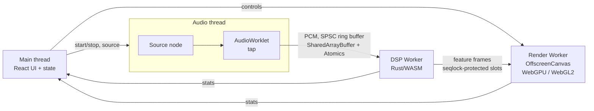

# Resonance: Real-Time Audio Visualizer (PRD v2)

## 1. Overview
Resonance is a browser-based, real-time music visualizer. It takes audio from a file, the microphone, a browser tab, or a bundled track. A custom DSP pipeline analyzes it, and GPU-rendered visuals react to bass, frequency content, rhythm, and harmony.

The visuals get attention. The engineering is what the repo has to prove:
- a multithreaded, lock-free audio → analysis → render pipeline
- signal processing implemented from scratch in Rust/WASM
- GPU compute programming
- measured performance and measured accuracy
- production-grade testing, CI/CD, and infrastructure

## 2. Goals and Non-Goals

### Goals
- **G1.** A polished app that looks great in a 10-second GIF and screenshots.
- **G2.** Systems engineering: concurrency, shared memory, timing/latency budgeting, graceful degradation.
- **G3.** DSP fundamentals implemented and *validated*, with accuracy metrics, not just "it looks like it works."
- **G4.** Ship like a product: tests, CI/CD, benchmarks, IaC, a deployed demo, and clear docs.

### Non-Goals
- No accounts, backend, database, or analytics. Audio never leaves the user's browser.
- No DRM'd streaming integrations (Spotify, Apple Music).
- Not mobile-first. Mobile must work at reduced quality; desktop is the showcase.

## 3. Audience and What the Repo Must Prove
| Reader | Time spent | Must come away with |
|---|---|---|
| Recruiter | 30-60 s | Hero GIF, one-line pitch, live demo, recognizable tech (Rust, WebGPU, AWS) |
| Engineer/interviewer | 5-10 min | Architecture diagram, threading model, perf/accuracy numbers, honest trade-offs, clean code |
| Hobbyist | Demo only | Drop in a song and it looks amazing |

Each section of this PRD should trace back to one of those rows.

## 4. Priorities and MVP Cut Line
Every requirement is tagged:
- **P0:** required for v1. The project isn't shippable without it.
- **P1:** strong differentiator. Build after all P0 is green.
- **P2:** polish or stretch. Only if time remains.

**MVP cut line:** all P0 items, deployed, with README, screenshots, and measured numbers. That alone is a complete portfolio project. P1 makes it exceptional.

## 5. Functional Requirements

### 5.1 Input and Playback
| ID | Requirement | Pri |
|---|---|---|
| IN-1 | Drag-and-drop or file picker for audio (mp3, wav, ogg, m4a/aac; flac where the browser decodes it) | P0 |
| IN-2 | 3 bundled CC0/royalty-free tracks with `ATTRIBUTION.md`, so the demo works with one click | P0 |
| IN-3 | Microphone input via `getUserMedia`, with echo cancellation, noise suppression, and AGC **disabled** (they distort the spectrum) | P0 |
| IN-4 | Browser-tab audio via `getDisplayMedia({ audio: true })`, where supported (Chromium). Hidden when unsupported | P1 |
| IN-5 | Transport: play/pause, seek, volume, loop. Seek bar shows the energy/beat timeline when available (see 5.2 DSP-9) | P0 |
| IN-6 | File limits: up to 15 minutes or 100 MB. Larger files get a clear error message rather than a frozen tab | P0 |
| IN-7 | Handle sample rates of 44.1 and 48 kHz (and others the device reports). All DSP parameters derive from the actual sample rate | P0 |

Playback path: files play through `HTMLAudioElement` → `MediaElementAudioSourceNode`. This streams instead of decoding the whole file into memory (a 10-minute stereo track decoded is roughly 230 MB). A separate decode is used only for offline analysis, downmixed to mono.

### 5.2 DSP Pipeline (Rust → WASM)
| ID | Requirement | Pri |
|---|---|---|
| DSP-1 | Mono downmix and STFT. Hann window, default 2048-sample frames and 512-sample hop, configurable | P0 |
| DSP-2 | Hand-written iterative radix-2 FFT (real-input optimization via half-size complex FFT is P1). Verified and benchmarked against `rustfft` | P0 |
| DSP-3 | Log-magnitude spectrum and 64-band mel filterbank (Slaney-style) | P0 |
| DSP-4 | Six band energies (sub-bass, bass, low-mid, mid, high-mid, treble) with attack/release envelope followers and slow auto-gain, so quiet and loud tracks both look good | P0 |
| DSP-5 | Onset detection: half-wave-rectified spectral flux on the log-mel spectrum, adaptive threshold (moving median + offset), peak picking with a minimum gap | P0 |
| DSP-6 | Tempo estimation: autocorrelation of the onset envelope, 60-180 BPM range, log-Gaussian tempo prior to reduce octave errors (e.g. 70 vs 140) | P0 |
| DSP-7 | Beat tracking: phase-locked beat predictor that emits beat events and a beat phase (0-1) for animation, recovering after tempo changes | P1 |
| DSP-8 | Chroma (12 pitch classes) and key estimation with Krumhansl-Schmuckler key profiles. Key maps to the color palette | P1 |
| DSP-9 | Offline analysis for files: a worker pre-computes the beat grid, energy timeline, and key, so visuals can anticipate beats instead of only reacting | P1 |
| DSP-10 | Spectral centroid and RMS loudness as extra animation drivers | P0 |
| DSP-11 | Zero heap allocation in the per-hop hot path. All buffers are pre-allocated at init | P0 |

**Output contract:** one fixed-layout **feature frame** per hop. It holds the frame index, an audio timestamp (in samples), band energies, 64 mel values, flux, onset flag, BPM, beat phase, chroma[12], key, centroid, and RMS. The schema is versioned and documented in `docs/feature-frame.md`.

### 5.3 Rendering
| ID | Requirement | Pri |
|---|---|---|
| RD-1 | Renderer interface with a WebGL2 backend | P0 |
| RD-2 | WebGPU backend with WGSL compute shaders for particle simulation | P1 |
| RD-3 | Rendering in a dedicated Worker via `OffscreenCanvas`, with fallback to main-thread rendering if unsupported | P0 |
| RD-4 | **Spectral Tunnel** mode: fragment-shader tunnel deformed by mel bands; works on WebGL2 | P0 |
| RD-5 | **Particle Nebula** mode: curl-noise particle field. Bass = radial impulses, treble = shimmer, beat = shockwave. 500k+ particles on WebGPU, reduced count on WebGL2 | P1 |
| RD-6 | **Chroma Bloom** mode: radial pitch-class visualization with key-driven palette | P2 |
| RD-7 | Crossfade transitions between modes | P1 |
| RD-8 | Post-processing: bloom, beat-triggered chromatic aberration, film grain. Each toggleable | P1 |
| RD-9 | Beat-synced camera motion | P1 |
| RD-10 | **Adaptive quality:** if frame time exceeds budget for ~1 s, scale down particle count, then render resolution; scale back up when there's headroom. Current quality level shows in the debug overlay | P0 |
| RD-11 | **Deterministic capture mode:** given a seed and an audio file, render at a fixed timestep driven by audio time (not wall-clock), frame by frame. Used for screenshots, GIF, and visual tests | P0 |
| RD-12 | Handle WebGPU device loss and WebGL context loss by rebuilding resources without reloading the page | P1 |
| RD-13 | Pause rendering when the tab is hidden (`visibilitychange`) to save battery | P0 |

### 5.4 UI
| ID | Requirement | Pri |
|---|---|---|
| UI-1 | Clean dark UI that auto-hides during playback and returns on mouse move or keypress | P0 |
| UI-2 | Control panel: mode, sensitivity, smoothing, particle count, color theme, post-FX toggles | P0 |
| UI-3 | **Debug overlay** (toggle with `D`): FPS, frame time, DSP time per hop, A/V sync error, ring-buffer overruns, active renderer and quality level, BPM, key, live spectrum and onset plots | P0 |
| UI-4 | Fullscreen, keyboard shortcuts (with a `?` help sheet), settings shareable via URL hash | P1 |
| UI-5 | Capability banner: tells the user which backend is active and why (e.g. "WebGPU unavailable, using WebGL2") | P0 |

### 5.5 Accessibility and Safety
| ID | Requirement | Pri |
|---|---|---|
| AX-1 | Photosensitivity warning on first load (remembered locally) | P0 |
| AX-2 | Flash limiter per WCAG 2.3.1: no more than 3 large luminance flashes per second, and saturated-red flashes are suppressed | P0 |
| AX-3 | Honor `prefers-reduced-motion`: lower intensity, no shockwaves or camera shake, plus a manual toggle | P0 |
| AX-4 | All controls keyboard-accessible with visible focus and ARIA labels. Axe checks pass in e2e | P0 |

### 5.6 Errors and Edge Cases
| ID | Requirement | Pri |
|---|---|---|
| ER-1 | Autoplay policy: `AudioContext` is created or resumed only on a user gesture; the UI shows a start prompt | P0 |
| ER-2 | Clear messages for mic/tab permission denied, unsupported format, decode failure, and file too large | P0 |
| ER-3 | If the page isn't cross-origin isolated (no `SharedArrayBuffer`), fall back to a `postMessage` transport and say so in the debug overlay | P0 |
| ER-4 | Silence or near-silence doesn't cause auto-gain to amplify noise into flashing (noise gate below a floor) | P0 |
| ER-5 | WASM load failure shows an error state instead of a blank canvas | P0 |

## 6. Architecture

### 6.1 Threads and data flow


### 6.2 Concurrency rules
- The audio thread never blocks, allocates, or posts messages per block. It only copies samples into the ring buffer.
- PCM ring buffer: single producer / single consumer, `Atomics` load/store on read and write indices, power-of-two capacity. **On overflow, drop the oldest data** and increment an overrun counter shown in the debug overlay.
- Feature frames: a small ring of slots with a **seqlock** (sequence counter checked before and after the read), so the renderer never reads a torn frame and never waits on the DSP worker.
- The renderer interpolates between the two frames that bracket its target time, so motion stays smooth at any refresh rate.

### 6.3 Timing and A/V sync
Visuals should match what the user *hears*, not what was just captured.
- **File playback:** audio is known ahead of time. The renderer targets the current *output* time from `AudioContext.getOutputTimestamp()` and `outputLatency`, and uses the feature frame for that moment (from live analysis run ahead, or the offline analysis). Goal: visuals line up with sound, not merely "low latency."
- **Mic/tab input:** the future is unknown, so the goal is minimal capture-to-photon latency.
- Every feature frame carries its audio timestamp. The debug overlay reports **A/V sync error** (file mode) or **input latency** (live mode).
- Measurement method is documented in `docs/latency.md`, including the limit that browser APIs only estimate output latency. An optional camera-based check (filming a click track and the screen) can validate the numbers.

### 6.4 Capability fallback chain
1. WebGPU in a Worker
2. WebGL2 in a Worker (`OffscreenCanvas`)
3. WebGL2 on the main thread
4. Transport: `SharedArrayBuffer` if cross-origin isolated, otherwise `postMessage`

Detection runs once at startup. The result is shown in the capability banner and recorded in the debug overlay.

## 7. Tech Stack
| Layer | Choice | Why |
|---|---|---|
| Languages | TypeScript (strict), Rust (stable) | Type safety; native-speed DSP |
| DSP build | `wasm-bindgen`, `wasm-pack`, `vite-plugin-wasm`; WASM SIMD where available, with a scalar fallback | Fast numeric code off the JS heap |
| Audio | Web Audio API, AudioWorklet | Low-latency audio-thread capture |
| Concurrency | Web Workers, SharedArrayBuffer, Atomics, OffscreenCanvas | UI, DSP, and render run independently |
| GPU | WebGPU (WGSL compute + render), WebGL2 (GLSL ES 3.0) | Modern GPU compute, broad compatibility |
| UI | React 18, Vite, Zustand | Fast dev loop, simple state |
| Monorepo | pnpm workspaces + Cargo workspace | One install, one CI |
| Testing | `cargo test`, `proptest`, Vitest, Playwright, axe-core | Unit, property, e2e, accessibility |
| Benchmarks | `criterion` (native), in-browser harness (WASM) | Real numbers for the README |
| CI/CD | GitHub Actions, AWS deploy via GitHub OIDC (no long-lived keys) | Secure, automated deploys |
| Hosting | S3 + CloudFront with Origin Access Control and a response headers policy, defined in AWS CDK (TypeScript) | Required COOP/COEP headers; cloud/IaC skills |
| Quality | ESLint, Prettier, `clippy -D warnings`, `rustfmt`, Husky + lint-staged | Clean repo hygiene |

Every asset is self-hosted (fonts, audio, WASM), because `Cross-Origin-Embedder-Policy: require-corp` blocks cross-origin resources that lack CORP headers.

## 8. Performance Targets and Methodology
**Reference hardware** (state the actual machine in the README): a mid-range laptop such as an M1/M2 MacBook Air or a laptop with integrated Intel Iris Xe graphics, Chrome stable.

| Metric | Target | How measured |
|---|---|---|
| Frame rate, 1080p, Spectral Tunnel (WebGL2) | 60 FPS sustained | p50/p95 frame time over a 60 s capture |
| Particle Nebula (WebGPU) | 500k particles at 60 FPS | Same, logging adaptive-quality level |
| DSP time per hop (WASM) | p95 < 1 ms | In-worker `performance.now()` histogram |
| A/V sync error, file mode | within ±15 ms | Output timestamp vs. frame target time |
| Input latency, live mode | < 50 ms (estimate) | Capture timestamp → frame present, plus reported `outputLatency` |
| Main-thread long tasks during playback | 0 | PerformanceObserver (`longtask`) |
| Ring-buffer overruns, 10-minute playback | 0 | Debug overlay counter |
| JS + WASM, gzipped | < 350 KB | CI fails if the budget is exceeded |
| Time to interactive, broadband | < 2 s | Lighthouse CI |
| Memory, 10-minute track | < 300 MB | Chrome task manager / `performance.measureUserAgentSpecificMemory` |

`npm run bench` produces `docs/benchmarks.md` with these numbers and the hardware they came from.

## 9. Testing and Accuracy Evaluation

### 9.1 Correctness tests (CI, every PR)
- **FFT:** a known sine lands in the expected bin; matches `rustfft` within 1e-4 relative error; Parseval's theorem holds; linearity.
- **Window and mel:** window sums and filterbank shapes match reference values.
- **Tempo:** synthetic click tracks at 70, 90, 120, 140, and 174 BPM detected within ±2 BPM (half/double counted separately).
- **Chroma and key:** synthetic major/minor chords and scales produce the expected pitch-class peaks and key.
- **Property tests (`proptest`):** ring buffer never loses ordering or exceeds capacity; FFT inverse round-trips.
- **Concurrency:** ring buffer and seqlock tested under stress in a multi-worker browser test.
- **Web unit tests (Vitest):** state store, URL-hash settings, capability detection.
- **e2e (Playwright):** load, start prompt, play fixture, switch modes, debug overlay shows real values, error states, axe accessibility checks.
- **Visual regression:** capture mode (RD-11) on the WebGL2 backend under software rendering (SwiftShader), compared with a pixel-difference tolerance, so results don't depend on the CI machine's GPU.

### 9.2 Accuracy evaluation (scripted, reported in README)
- `npm run eval` runs onset and beat detection against annotated tracks and reports **F-measure with a ±70 ms tolerance**, the standard MIR evaluation metric. Tempo accuracy is reported as Acc1 (within 4%) and Acc2 (also allowing half/double).
- Dataset: the synthetic fixtures plus a small set of permissively licensed tracks with hand-made beat annotations committed to the repo. Licenses are recorded in `ATTRIBUTION.md`.
- Results go in `docs/evaluation.md` and a summary table in the README. Honest numbers beat impressive-sounding ones.

## 10. Browser Support
Support changes quickly, so verify current status at build time. The app must not depend on any one browser.

| Browser | Target experience |
|---|---|
| Chrome / Edge (desktop) | Full: WebGPU, worker rendering, tab audio |
| Firefox / Safari (desktop) | WebGPU where shipped and stable, otherwise WebGL2. All P0 features work |
| Mobile Safari / Chrome Android | WebGL2, reduced particle count, file and mic input |

The capability banner (UI-5) always shows what's active.

## 11. Repo Structure
```
resonance/
├─ crates/dsp/            # Rust DSP library: src/, tests/, benches/
├─ packages/web/          # Vite + React + TS app
│  ├─ src/audio/          # AudioWorklet, ring buffer, input sources, clock/sync
│  ├─ src/workers/        # dsp.worker.ts, render.worker.ts
│  ├─ src/render/         # backend/{webgpu,webgl2}/, modes/, shaders/, postfx/
│  ├─ src/ui/
│  └─ public/audio/       # bundled tracks + synthetic fixtures
├─ infra/                 # AWS CDK stack
├─ eval/                  # annotations + evaluation scripts
├─ docs/                  # architecture, feature-frame, latency, dsp-notes,
│                         # benchmarks, evaluation, decisions/ (ADRs), screenshots/
├─ scripts/               # capture (screenshots + GIF), bench, fixture generation
├─ .github/workflows/
├─ PRD.md
└─ README.md
```

Major design choices get a short Architecture Decision Record in `docs/decisions/` (e.g. "Why Rust/WASM over JS DSP", "Why seqlock for feature frames", "Why MediaElementSource for playback").

## 12. Infrastructure and CI/CD
- **CI on every PR:** format, lint, type-check, `cargo clippy -D warnings`, `cargo test`, Vitest, Playwright e2e and visual tests, bundle-size budget, Lighthouse CI.
- **CD on merge to `main`:** build, then `cdk deploy` through GitHub OIDC role assumption, then a CloudFront invalidation, then a post-deploy smoke test that checks the live site responds with the COOP/COEP headers and that `crossOriginIsolated === true`.
- **CDK stack:** private S3 bucket, CloudFront with Origin Access Control, HTTPS only, response headers policy (COOP `same-origin`, COEP `require-corp`, CSP, HSTS, `X-Content-Type-Options`), correct `application/wasm` MIME type, long cache lifetimes for hashed assets and no-cache for `index.html`.
- **Cost:** within AWS free-tier levels for portfolio traffic. Note it in the README.
- **Preview builds** per PR are P2.

## 13. README and Docs Requirements
The README is a deliverable, not an afterthought. A recruiter must get the point from the first screen.
1. Title, one-line pitch, badges (CI, deploy, license)
2. **Hero GIF** (8-12 s, all available modes reacting to music), produced by capture mode
3. **Live demo link** and "Try it with your own song. Audio never leaves your browser."
4. **Highlights** (5-6 bullets, each with a number where possible), e.g. hand-written FFT at X µs per hop, lock-free 3-thread pipeline, 500k GPU particles at 60 FPS, beat F-measure of X
5. **Screenshot gallery:** each mode, debug overlay, settings panel, fallback banner
6. **Architecture:** the Mermaid diagram from section 6 and a short paragraph on threading and sync
7. **Performance** and **accuracy** tables, real numbers, test hardware listed
8. **How it works:** short DSP explainer linking `docs/dsp-notes.md`
9. **Engineering decisions and trade-offs:** links to the ADRs, plus 2-3 real problems hit during development and how they were solved
10. Quickstart (5 commands or fewer), project structure, testing, deployment
11. Browser support, accessibility and photosensitivity notes, known limitations, attribution, license (MIT)

All screenshots and the GIF come from `npm run capture`, using capture mode (RD-11) and fixed fixtures, so they're reproducible and never hand-edited. A short screen-recorded demo video (60-90 s) linked from the README is P2.

## 14. Milestones
Each milestone ends with green CI and a commit. ★ marks the MVP cut line.

| # | Milestone | Key IDs |
|---|---|---|
| 1 | Scaffold: pnpm + Cargo workspaces, Vite/React/TS, WASM build wiring, COOP/COEP dev headers, CI skeleton, fixture generator | — |
| 2 | Audio pipeline: sources, transport, AudioWorklet, SPSC ring buffer, postMessage fallback, error states | IN-1..3, IN-5..7, ER-1..3 |
| 3 | DSP core: FFT, STFT, mel, band energies, centroid/RMS, auto-gain; tests + benchmarks; WASM integration | DSP-1..5, DSP-10..11 |
| 4 | Tempo: onset envelope, autocorrelation tempo; click-track tests | DSP-6 |
| 5 | Rendering v1: renderer interface, WebGL2 backend, Spectral Tunnel, worker/main-thread fallback, adaptive quality, visibility pause | RD-1, RD-3, RD-4, RD-10, RD-13 |
| 6 | UI and safety: controls, debug overlay, capability banner, photosensitivity warning, flash limiter, reduced motion, a11y | UI-1..3, UI-5, AX-1..4, ER-4..5 |
| 7 | Timing: output-clock sync, A/V sync measurement, `docs/latency.md` | §6.3 |
| 8 | Capture mode, screenshots, GIF, visual regression tests | RD-11 |
| 9 | Infra and deploy: CDK stack, OIDC CD, smoke test, live demo | §12 |
| 10 | ★ Docs: README, architecture docs, ADRs, benchmarks. **MVP complete** | §13 |
| 11 | WebGPU backend + Particle Nebula, device-loss handling | RD-2, RD-5, RD-12 |
| 12 | Beat tracking, chroma/key, offline analysis + timeline, accuracy eval | DSP-7..9, IN-5 timeline, §9.2 |
| 13 | Post-FX, transitions, beat camera, tab audio, shortcuts, URL settings | RD-7..9, IN-4, UI-4 |
| 14 | Chroma Bloom and P2 polish; refresh README numbers, screenshots, and GIF | RD-6 |

## 15. Risks and Mitigations
| Risk | Mitigation |
|---|---|
| COOP/COEP breaks third-party assets or hosting | Self-host everything; CloudFront headers policy; postMessage fallback (ER-3) |
| WebGPU missing or unstable on a reader's machine | WebGL2 is the P0 baseline; WebGPU is an enhancement (§6.4) |
| Headless CI can't run WebGPU or real GPUs | Visual tests use WebGL2 + SwiftShader; WebGPU verified manually and documented |
| Output-latency APIs are estimates | Document limits in `docs/latency.md`; optional camera-based validation |
| Tempo octave errors on real music | Tempo prior (DSP-6); report Acc1 and Acc2 honestly |
| Large files exhaust memory | Stream playback via media element; cap size/length (IN-6); mono offline decode |
| Flashing visuals trigger photosensitive users | Warning, WCAG flash limiter, reduced motion (§5.5) |
| Scope creep | P0/P1/P2 tags and the MVP cut line; no P1 work while P0 is red |

## 16. Stretch Goals (after P1)
- On-device ML mood/genre tagging with ONNX Runtime Web driving the palette
- Record visuals + audio to video via `MediaRecorder`
- MIDI/OSC beat output (Web MIDI)
- WebXR mode
- Plugin API for community visual modes

## 17. Success Criteria
- Live demo deployed. `crossOriginIsolated` is true in production, verified by the smoke test.
- All P0 requirements pass on Chrome, Firefox, and Safari desktop, plus one mobile browser.
- Section 8 metrics are measured, published, and meet target, or each miss is listed under "Known limitations" with the reason.
- Beat/onset F-measure and tempo accuracy are published from `npm run eval`.
- CI is green; Rust coverage is reported.
- README follows section 13, and every screenshot comes from capture mode.
- An engineer can explain the threading and sync design from `docs/` alone.
