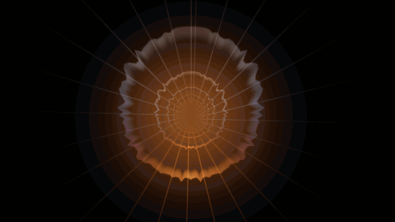
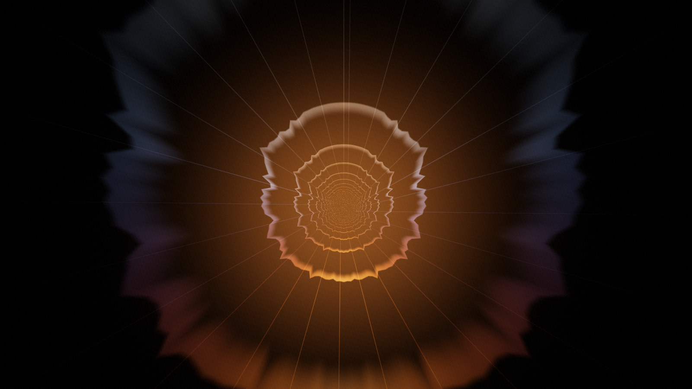
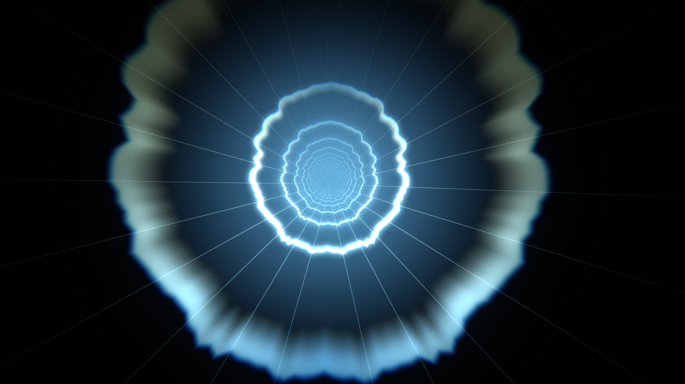
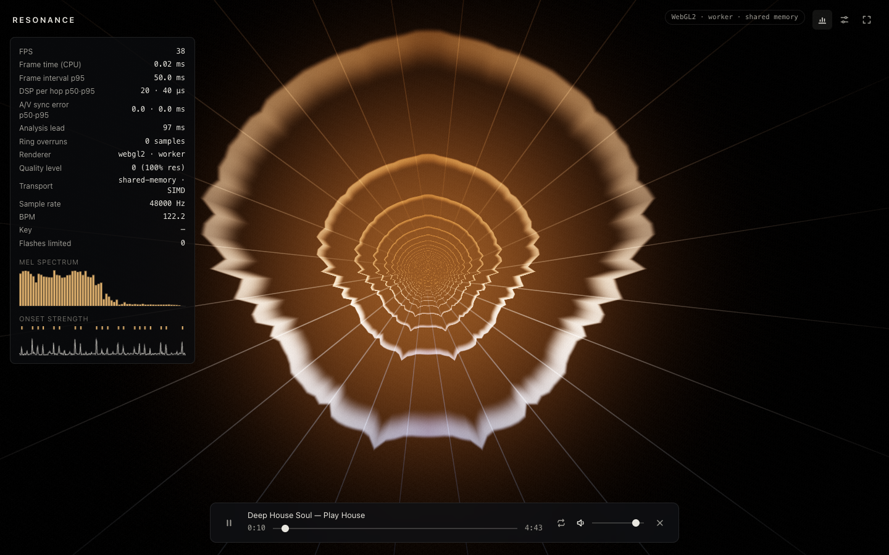
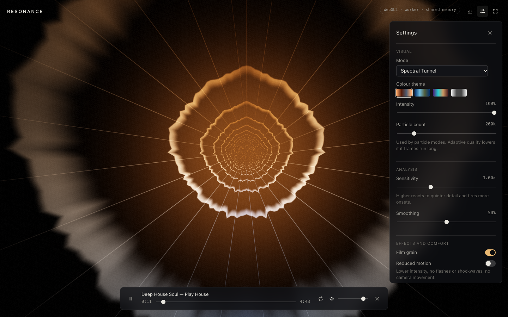
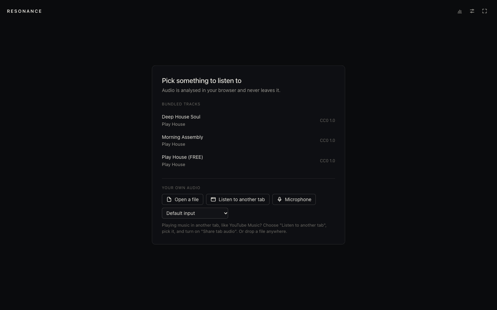
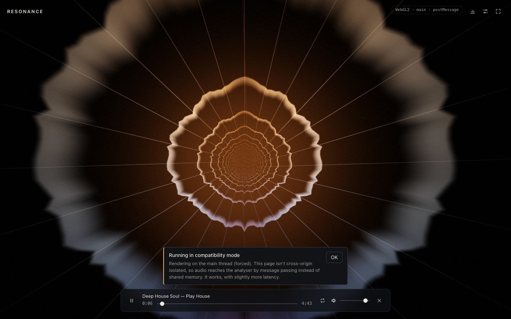
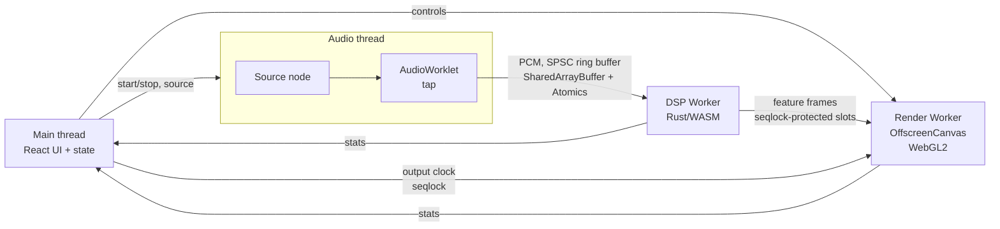

# Resonance

A real-time music visualizer for the browser: a lock-free audio → analysis → render pipeline
across four threads, with signal processing written from scratch in Rust/WebAssembly and
measured for speed and accuracy.

[](https://github.com/nithish101/resonance/actions/workflows/ci.yml)
[](https://github.com/nithish101/resonance/actions/workflows/deploy.yml)
[](LICENSE)



**Live demo:** not deployed yet. The AWS stack and CD pipeline are ready ([docs/deploy.md](docs/deploy.md)).
Run it locally in three commands (below). Try it with your own song, or play YouTube Music in
another tab and visualize that. Audio never leaves your browser.

## Highlights

- **Hand-written FFT and analysis in Rust/WASM: 15 µs per hop in the browser** (mean, SIMD
  build), 0.14% of the 10.7 ms real-time budget, with zero heap allocations per hop (enforced by
  a counting-allocator test). The radix-2 FFT matches `rustfft` to within 1e-4 at every size from
  2 to 16384.
- **Lock-free pipeline across four threads.** The AudioWorklet writes a SharedArrayBuffer ring;
  the DSP worker publishes feature frames through seqlocks; the renderer reads them in an
  OffscreenCanvas worker. **0 ring overruns and 0 main-thread long tasks over a 10-minute
  playback soak.**
- **60 FPS at 1080p** (frame interval p95 16.7 ms over 60 s) on an Apple M5, WebGL2 in a render
  worker, with adaptive quality that never had to step down.
- **Visuals synced to what you hear, not what was captured.** Files play through a 100 ms
  lookahead and the renderer targets the audio output clock (`getOutputTimestamp`). Live input
  from a mic, another tab, or the whole system runs at minimum latency.
- **Measured accuracy.** Onset F-measure 1.000 on click tracks and 0.928 on humanized grooves
  (±70 ms); tempo Acc1 14/14 with no octave errors from 70 to 174 BPM. The mel filterbank
  matches librosa weight for weight.
- **Shipped like a product:** 104 KB gzipped (JS + CSS + WASM), Lighthouse 100/100/100, zero axe
  violations, 46 e2e tests including visual regression and measured WCAG flash limits, and AWS
  CDK with GitHub OIDC deploys.

## Screenshots

|                                                                                                    |                                                                                     |
| -------------------------------------------------------------------------------------------------- | ----------------------------------------------------------------------------------- |
|                                  |                     |
| Spectral Tunnel, Ember                                                                             | Spectral Tunnel, Tide                                                               |
|    |                                     |
| Debug overlay (`D`): real readings                                                                 | Settings (`S`)                                                                      |
|  |  |
| Start screen                                                                                       | Fallback banner (main-thread rendering, postMessage transport)                      |

Every image is generated by `pnpm capture` from deterministic capture mode or the live app
([how](docs/screenshots/README.md)). Nothing is hand-edited.

## Architecture



The main thread owns the `AudioContext` and the UI, and nothing else. An AudioWorklet downmixes
each 128-sample render quantum into a single-producer, single-consumer ring in a
`SharedArrayBuffer`. It never blocks or allocates; on overflow the consumer drops the oldest
audio and counts it. The DSP worker runs the Rust analyzer once per 512-sample hop and writes a
fixed-layout feature frame into a ring of seqlock-protected slots, which the render worker reads
without ever waiting. Every frame carries the audio-context time of its window's centre. The
renderer compares that with the output clock, published by the main thread through a third
seqlock, and interpolates between the two frames around the moment you're hearing. Without
cross-origin isolation, the same components fall back to direct `MessagePort` channels.
Full details: [docs/architecture.md](docs/architecture.md), [docs/latency.md](docs/latency.md).

## Performance

From `pnpm bench` on an Apple M5 (16 GB), Chromium 156 with ANGLE on Metal. Full report,
including methodology and the native numbers: [docs/benchmarks.md](docs/benchmarks.md).

| Metric                                            | Target     | Measured                                                                                    |
| ------------------------------------------------- | ---------- | ------------------------------------------------------------------------------------------- |
| Frame rate, 1080p Spectral Tunnel (WebGL2 worker) | 60 FPS     | 60.0 FPS, interval p95 16.7 ms                                                              |
| DSP time per hop (WASM)                           | p95 < 1 ms | 30 µs p95 (SIMD), 65 µs (scalar)                                                            |
| A/V sync error, file mode                         | ±15 ms     | 0.0 ms p95 in software ([what that means](docs/latency.md#what-this-does-and-doesnt-prove)) |
| Input latency, live mode (estimate)               | < 50 ms    | 35.3 ms (1024/256 STFT for live input)                                                      |
| Main-thread long tasks during playback            | 0          | 0 (10-minute soak)                                                                          |
| Ring-buffer overruns, 10 minutes                  | 0          | 0                                                                                           |
| JS + WASM, gzipped                                | < 350 KB   | 104.2 KB                                                                                    |
| Largest Contentful Paint / Total Blocking Time    | TTI < 2 s  | 327 ms / 0 ms (Lighthouse desktop)                                                          |
| Memory, 10-minute playback                        | < 300 MB   | 4.6 MB JS/DOM/ArrayBuffers across page and workers (excludes GPU and media buffers)         |
| FFT 2048, native, vs rustfft                      |            | 6.3 µs vs 3.1 µs                                                                            |

## Accuracy

From `pnpm eval` ([docs/evaluation.md](docs/evaluation.md)). Onsets are scored with the standard
±70 ms F-measure; tempo with Acc1 (within 4%) and Acc2 (also half/double).

| Dataset                                               | Onset F           | Tempo Acc1 | Tempo Acc2 |
| ----------------------------------------------------- | ----------------- | ---------- | ---------- |
| Click tracks, 70-174 BPM (5)                          | 1.000             | 5/5        | 5/5        |
| Clean grooves (2)                                     | 0.981             | 2/2        | 2/2        |
| Humanized grooves: jitter, swing, velocity, noise (7) | 0.928             | 7/7        | 7/7        |
| Real music (3 bundled songs)                          | not annotated yet |            |            |

These are synthetic fixtures with exact ground truth, so treat them as an upper bound. Real-song
scoring waits on hand-tapped beat annotations; using Resonance's own output as ground truth would
make the evaluation circular.

## How it works

Each 512-sample hop, the analyzer:

1. slides a 2048-sample Hann window over the audio,
2. computes the spectrum with a hand-written real FFT (a half-size complex radix-2 FFT plus an
   untangling pass),
3. maps the power spectrum onto 64 Slaney mel bands and six bass-to-treble bands with
   envelopes, slow auto-gain, and a noise gate, so quiet tracks fill the screen and silence stays
   black,
4. detects onsets from the positive rise of the log-mel spectrum against a moving-median
   threshold,
5. estimates tempo by autocorrelating that onset envelope and scoring 60-180 BPM over the first
   four multiples of each period, with a log-Gaussian prior that suppresses octave errors.

The Spectral Tunnel wraps the mel spectrum around the tunnel walls, drives forward motion from
loudness, and pulses on onsets through a WCAG flash limiter. The maths, the parameters, and how
each piece is verified: [docs/dsp-notes.md](docs/dsp-notes.md). Frame layout:
[docs/feature-frame.md](docs/feature-frame.md).

## Engineering decisions and trade-offs

Architecture Decision Records:
[WASM build and loading](docs/decisions/0001-wasm-build-and-loading.md) ·
[PCM ring with consumer-side drop-oldest](docs/decisions/0002-pcm-ring-buffer.md) ·
[Media-element playback and lookahead](docs/decisions/0003-playback-path-and-lookahead.md) ·
[Rust/WASM over JS DSP](docs/decisions/0004-rust-wasm-dsp.md) ·
[Seqlock feature frames](docs/decisions/0005-seqlock-feature-frames.md) ·
[Render worker and fallbacks](docs/decisions/0006-render-worker-and-fallbacks.md) ·
[Deterministic capture](docs/decisions/0007-deterministic-capture.md)

Problems hit along the way:

- **"Drop oldest" without breaking single-writer ownership.** The usual SPSC ring drops the
  newest data when full; dropping the oldest normally means the producer moves the read index,
  which takes a CAS loop on the audio thread. Instead, the producer never looks at the read
  index. The consumer detects overwrites itself, before and after each copy, and discards
  anything possibly torn. A three-regime multi-worker stress test checks that every delivered
  sample equals its stream index and that consumed + dropped == produced.
- **False onsets from beating partials.** Spectral flux in dB picked up faint amplitude beating
  between sustained chord partials (precision 0.81). A single noise floor fixed that but erased
  the hi-hats, because Slaney normalization puts high, wide mel bands on a much lower dB scale
  (recall 0.63). Flooring each band against its own history fixed both (F 0.98).
- **A sync metric that's zero by construction.** With a lookahead, the renderer can always show
  exactly the frame for the output timestamp, so the PRD's software metric reads 0 ms. That
  says nothing about speakers or displays, so rather than quote it as proof the docs explain the
  limit and ship a calibration mode for a camera check.
- **Tests that failed because the laptop's display was asleep.** Chromium's audio clock runs off
  the output device's callbacks, and with the machine idle it froze after 10.7 ms. Every test and
  script now uses Chromium's timer-driven fake audio output: silent, and the same on CI.

More in [docs/plan.md](docs/plan.md#problem-log).

## Quickstart

Requires Node 20+, pnpm (`corepack enable`), and Rust stable with `wasm-pack`
(`cargo install wasm-pack`).

```sh
git clone https://github.com/nithish101/resonance && cd resonance
pnpm install
pnpm dev            # builds WASM + fixtures, serves http://localhost:5173 with COOP/COEP
```

| Command                      | What it does                                           |
| ---------------------------- | ------------------------------------------------------ |
| `pnpm test`                  | Rust tests, Vitest, and Playwright e2e (all)           |
| `pnpm bench`                 | Measures everything above; writes `docs/benchmarks.md` |
| `pnpm eval`                  | Accuracy evaluation; writes `docs/evaluation.md`       |
| `pnpm capture`               | Regenerates screenshots and the hero GIF               |
| `cargo test` / `cargo bench` | Rust only (criterion benchmarks against rustfft)       |

## Project structure

```
crates/dsp        Rust DSP: FFT, STFT, mel, bands, onsets, tempo (tests, proptest, criterion)
crates/dsp-wasm   wasm-bindgen bindings
crates/fixtures   deterministic synthetic audio with exact ground truth
crates/eval       accuracy evaluation
packages/web      Vite + React + TypeScript app, workers, worklet, renderer, e2e tests
infra             AWS CDK: private S3 + CloudFront (OAC, COOP/COEP/CSP/HSTS) + GitHub OIDC role
scripts           build-wasm, capture, bench, smoke test, size budget, deploy
docs              architecture, latency, DSP notes, frame layout, benchmarks, evaluation, ADRs
```

## Testing

- **Rust:** FFT against rustfft, Parseval, linearity, and a proptest inverse round-trip; the mel
  filterbank against librosa; analyzer behaviour (sine centroid, silence stays dark, auto-gain,
  onsets on click tracks and grooves); tempo on click tracks at 70/90/120/140/174 BPM; a
  zero-allocation check. Coverage is reported in CI (`cargo llvm-cov`).
- **Web unit (Vitest):** ring buffer property tests (fast-check), frame bus and reader, flash
  limiter against 4-20 Hz strobes, adaptive quality, clock maths, error mapping, and a parity
  test between the Rust and TypeScript frame layouts.
- **e2e (Playwright, 46 tests):** start prompt, every source (bundled track, file, mic, real
  two-tab capture), every error state, the postMessage fallback, worker and main-thread
  rendering, debug overlay values, keyboard operation, axe checks, A/V sync, a multi-worker
  ring/seqlock stress test, visual regression against goldens under SwiftShader, and WCAG
  flash counts measured on rendered frames.
- **Infrastructure:** CDK assertion tests, `actionlint`, and a smoke test that runs against the
  production build in CI and against the live site after each deploy.

## Deployment

`infra/` defines a private S3 bucket behind CloudFront (Origin Access Control, HTTPS only,
HTTP/2 and 3). A response headers policy sets COOP/COEP (for `SharedArrayBuffer`), CSP with
`wasm-unsafe-eval`, and HSTS, generated from the same file `vite preview` serves, so every e2e run
tests the production CSP. GitHub Actions deploys through OIDC with no stored AWS keys,
invalidates the CDN, and smoke-tests the live site. Within the AWS free tier for portfolio
traffic. Setup steps: [docs/deploy.md](docs/deploy.md).

## Browser support

| Browser                    | Experience                                                                                                                                                                                |
| -------------------------- | ----------------------------------------------------------------------------------------------------------------------------------------------------------------------------------------- |
| Chrome / Edge (desktop)    | Everything: worker rendering, shared memory, tab and system audio capture                                                                                                                 |
| Firefox / Safari (desktop) | All core features; tab capture isn't offered because these browsers return no audio from screen sharing. A loopback input device works instead ([guide](docs/listening-to-other-apps.md)) |
| Mobile                     | File and microphone input; rendering adapts its resolution                                                                                                                                |

The capability pill and banner always show which renderer and transport are active, and why.

## Accessibility and photosensitivity

- A photosensitivity notice appears before any visuals react, with an option to continue with
  reduced motion.
- Brightness flashes are limited to three per second (WCAG 2.3.1), measured on rendered frames
  in CI, and saturated-red flashes are suppressed.
- `prefers-reduced-motion` is honoured, with a manual toggle.
- Every control works from the keyboard with visible focus and ARIA labels; axe-core reports no
  WCAG 2.1 AA violations.

## Known limitations

- **No live demo yet.** It needs an AWS account; the stack and pipeline are ready.
- **Screenshots and the hero GIF predate the Particle Nebula.** Rerun `pnpm capture` to include it.
- **Beat tracking, chroma/key, and offline timelines aren't built yet** (P1). Their fields are
  reserved in the feature frame.
- **Real-music accuracy is unmeasured** until the bundled songs have hand-tapped annotations.
  Published accuracy is on synthetic audio, an upper bound.
- **A/V sync is verified in software only.** Speaker and display latency need the camera check
  ([latency.md](docs/latency.md)). Bluetooth output adds delay that browsers often don't report.
- **Benchmarks come from one machine** (Apple M5), faster than the PRD's reference laptop. Only
  Chromium is automated; Firefox and Safari were not tested.

## Attribution and license

Bundled music by Play House, CC0 1.0, from the Free Music Archive. Details and checksums in
[ATTRIBUTION.md](ATTRIBUTION.md). Code is [MIT](LICENSE).
