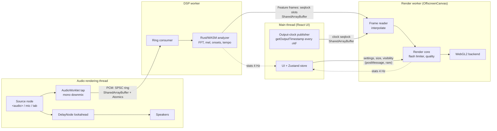

# Architecture

Resonance runs on four threads, and the main thread is not on the audio path. Audio flows from
the audio thread to the DSP worker to the render worker through shared memory, with no locks
and no per-block messages. This document is meant to be enough to explain the threading and sync
design without reading the code.

## Threads and data flow



| Thread               | Owns                                                                     | Never does                                            |
| -------------------- | ------------------------------------------------------------------------ | ----------------------------------------------------- |
| Main                 | React UI, `AudioContext`, media element, transport, clock sampling       | Touch audio samples or feature frames on the hot path |
| Audio (AudioWorklet) | Downmix + ring writes, one per render quantum (128 samples, 2.7 ms)      | Block, allocate, or post a message per block          |
| DSP worker           | Ring reads, one WASM `process()` per hop (512 samples), frame publishing | Wait on the renderer                                  |
| Render worker        | Frame reads, interpolation, visual state, WebGL2 draw                    | Wait on the DSP worker                                |

## The two shared-memory channels

### PCM: single-producer single-consumer ring

`packages/web/src/audio/shared/ring.ts`, [ADR 0002](decisions/0002-pcm-ring-buffer.md).

- 32768 float32 slots (0.68 s at 48 kHz), power-of-two so indices wrap with a mask.
- The worklet writes samples, then publishes `write` with `Atomics.store` and wakes the DSP
  worker with `Atomics.notify`. It never reads `read` and never waits.
- The DSP worker owns `read`. If it falls behind, the producer overwrites the oldest samples;
  the consumer detects that before and after copying ("drop oldest"), discards anything that
  might be torn, and adds the count to an overrun counter shown in the debug overlay.
- The DSP worker sleeps in `Atomics.waitAsync` on the write index (falling back to a 3 ms poll),
  so it wakes within microseconds of new audio without spinning.

### Feature frames: seqlock-protected slots

`packages/web/src/lib/frames.ts`, [ADR 0005](decisions/0005-seqlock-feature-frames.md),
layout in [feature-frame.md](feature-frame.md).

- 128 slots of 480 bytes, indexed by hop number modulo 128 (1.4 s of history at 48 kHz).
- Writer: increment the slot's sequence number (odd = writing), write the payload, increment
  again (even), publish the newest index.
- Reader: read the sequence; if odd, retry; copy; re-read; if it changed, retry. The renderer
  never sees a torn frame and never makes the DSP worker wait. Under a three-reader stress test
  with 200,000 frames, no torn frame was ever accepted.

### Fallback: postMessage

If the page isn't cross-origin isolated (no `SharedArrayBuffer`, ER-3), the same components talk
over `MessagePort`s wired directly between threads: the worklet posts 1024-sample transferable
batches straight to the DSP worker, and the DSP worker posts each frame straight to the render
worker, which mirrors them into a local (non-shared) frame bus. The reader code is identical in
both transports; only the delivery differs. The debug overlay and capability banner say which
transport is active.

## Timing and sync

Every feature frame is stamped with the audio-context sample position of its analysis window's
centre. The main thread samples `AudioContext.getOutputTimestamp()` every animation frame and
publishes it through a third seqlock (`lib/clock.ts`). The render worker extrapolates that
sample to its own `now` using `performance.timeOrigin + performance.now()`, which is comparable
across threads.

- **Files:** playback runs through a 100 ms `DelayNode`, so analysis is 100 ms ahead of the
  speakers. The renderer targets `output time - 100 ms` (the tap position of what's audible right
  now) and interpolates between the two frames that bracket it.
- **Live input:** there is no future to look at, so the renderer draws the newest frame and the
  overlay estimates capture-to-photon latency.

Details, measured numbers, and the limits of what software can measure:
[latency.md](latency.md).

## Rendering and the fallback chain

Capability detection runs once at startup (`audio/capabilities.ts`); the result drives this
chain and appears in the capability banner:

1. WebGPU in a worker _(P1, milestone 11)_
2. WebGL2 in a worker via `OffscreenCanvas` (the P0 baseline)
3. WebGL2 on the main thread (if `OffscreenCanvas` WebGL2 isn't available, or the worker fails
   to start; `?renderer=main` forces it)

The render core (`render/core.ts`) is shared by all three. It derives the visual state (travel
distance, onset pulse, smoothed bass) from **audio time**, not wall time. The interactive loop and
the deterministic capture mode (RD-11) therefore produce the same pixels for the same audio
([ADR 0007](decisions/0007-deterministic-capture.md)). Adaptive quality steps particle count and
then resolution against the measured display refresh. Rendering stops while the tab is hidden.

## Where things live

```
crates/dsp/          FFT, STFT, mel, bands, onsets, tempo; tests, proptest, criterion
crates/dsp-wasm/     wasm-bindgen bindings (pointers into WASM memory, no copies)
crates/fixtures/     deterministic synthetic audio with exact ground truth
crates/eval/         `pnpm eval`
packages/web/src/
  audio/             engine (graph, sources, transport), worklet tap, ring buffer, errors
  workers/           dsp.worker.ts, render.worker.ts, WASM analyzer wrapper
  lib/               frame bus, clock, protocol types, WASM loader
  render/            render core, frame reader, flash limiter, quality, WebGL2 backend, shaders
  app/               store, controller, render host (main-thread side of rendering)
  ui/                React components
  capture/           deterministic capture page (RD-11)
infra/               AWS CDK: S3 + CloudFront + headers policy, GitHub OIDC role
scripts/             build-wasm, capture, bench, smoke, size budget, deploy
```
